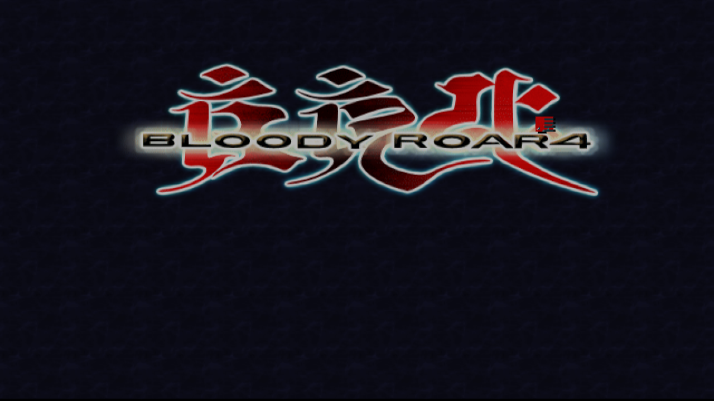
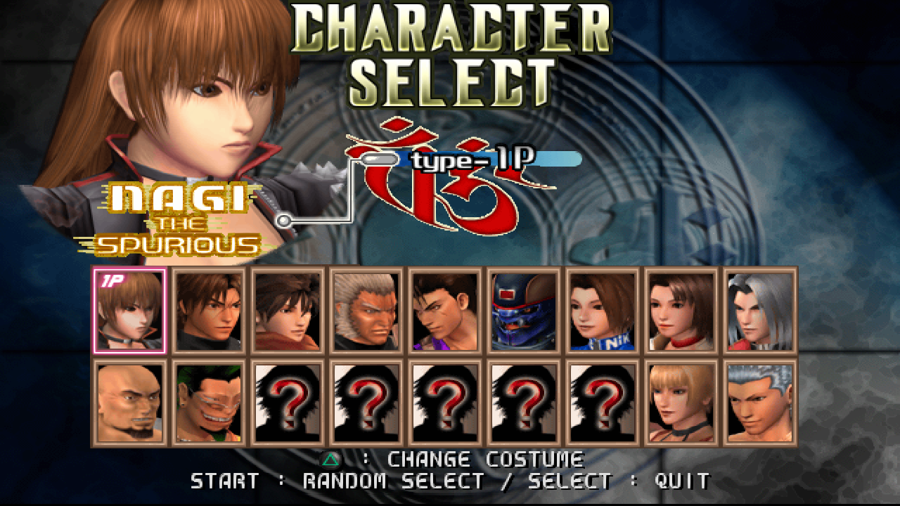
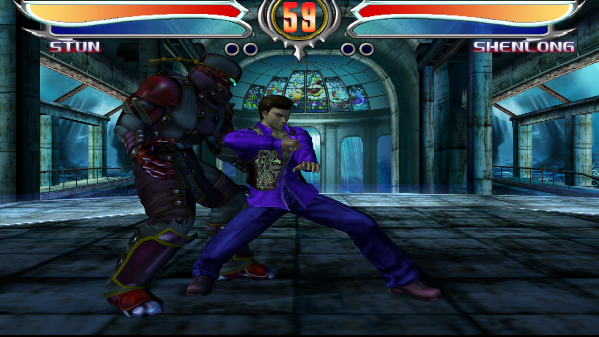
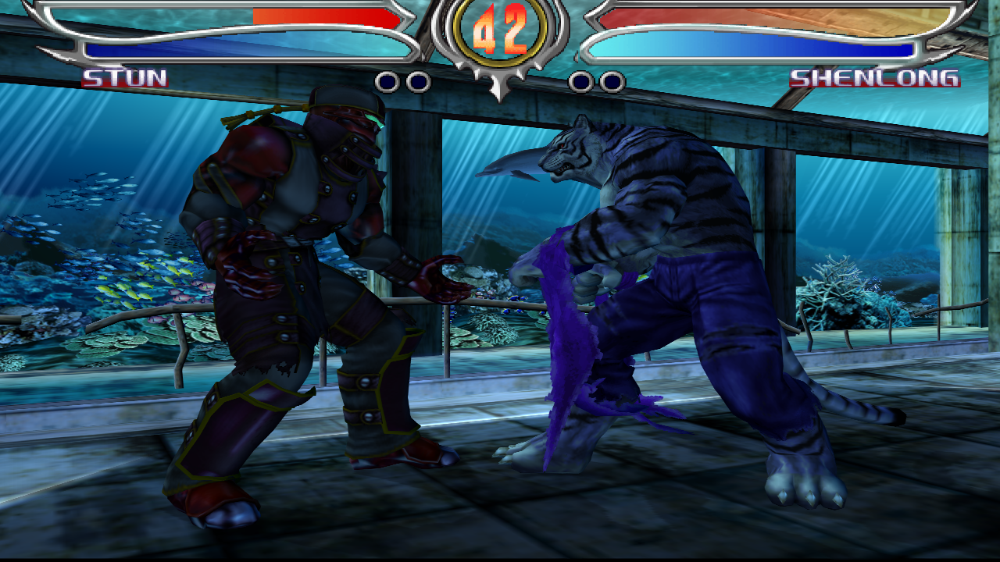
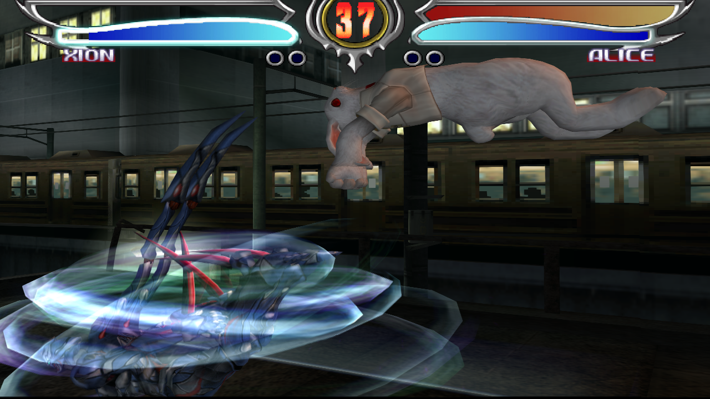
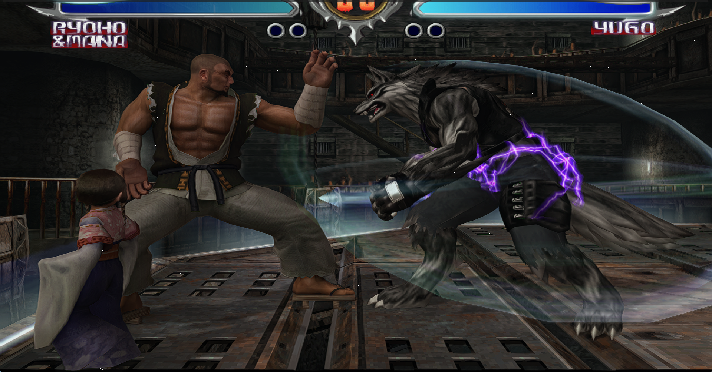

# Bloody Roar 4 [Analog Stick Mod] — native port for PC

**English** | [Español](README.es.md)

Play **Bloody Roar 4** (PS2, PAL **SLES-51877**) with the **Analog Stick Mod** as a native **Windows**
program: 60 fps, high resolution, 16:9, NVIDIA DLSS (and the experimental "DLSS 5" neural pass),
controller support. The game is recompiled to native x64 code with
[PS2Recomp](https://github.com/ran-j/PS2Recomp) and drawn on your GPU by the
[PCSX2](https://github.com/PCSX2/pcsx2) renderer, the same way as the
[NBA Street V3](https://github.com/recomp-code/street-recomp-v3) and
[Dragon Ball Z Budokai Tenkaichi 4](https://github.com/recomp-code/dbz-bt4-recomp) ports.

> **You need your own copy** of Bloody Roar 4 [Analog Stick Mod] (PAL, SLES-51877) as an ISO file.
> Nothing from the game is included: it is built on your computer from your copy.

| | |
|---|---|
|  |  |
|  |  |
|  |  |

*Captured on the native build (RTX 4090): 16:9, 6x internal resolution; the last one with DLSS 5 at 1920x1080.*

### Video: a fight with DLSS 5

https://github.com/user-attachments/assets/23eedfea-f4db-4fab-adbd-fd0a7248ac42

*Busuzima vs. Uriko with every quality option on: "DLSS 5" (Direct3D 12, NVIDIA DLSS with the RenoDX
neural pass on top), 16:9, 60 fps, with the game's own sound. 30 s highlights at 720p60 (GitHub only plays
videos up to 10 MB inline; [file](docs/videos/br4_dlss5_highlights.mp4)).*
**[▶ Full video, 2:30 at 2488x1400 60 fps (AV1): title screen, character select and the whole fight](docs/videos/br4_dlss5_full.mp4)**

Recorded on the native build with `tools\record_video_dlss5.ps1` (the window as it is shown, so the neural pass is
in it, plus the runtime's audio through `PS2X_WAVCAP`).

## Status

Playable: boot, memory card (AUTO LOAD), the HUDSONCI and OPENING videos, title, character select and
fights, with music (streamed BGM) and sound effects, at full speed. Not every mode has been played
through yet: please open an issue if something breaks.

## Features

- **Native on Windows (x64).** The game's code is recompiled to native code: no CPU emulator while
  you play.
- **60 fps** in fights and menus, even though the disc is PAL (50 Hz): the runtime generates VBlank at
  60 Hz, so the game runs at the speed of the NTSC version. Videos play at their own 25 fps.
- **Analog Stick Mod built in:** the pad is always in analog mode and the left stick moves like the
  D-pad (8 directions). On a console you had to press ANALOG first.
- **Widescreen 16:9** (on by default), from ElHecht's widescreen patch for SLES-51877; or the original 4:3.
- **Three picture presets** in the launcher:
  - **6x supersampling** (Vulkan, any GPU): 6x internal resolution, 16x anisotropic filtering, FXAA,
    CAS sharpening. The sharpest picture.
  - **NVIDIA DLSS** (RTX): 2x internal resolution upscaled to your screen by DLSS (AMD FSR 1 on other GPUs).
  - **DLSS 5** (RTX, experimental): Direct3D 12 + DLSS with NVIDIA's neural pass on top (DLSS Neural
    Rendering through ReShade and the RenoDX DLSS 5 add-on, taken from your
    [DLSS 5 Swapper](#dlss-5) install). F6 switches the neural pass on and off to compare.
- **Your own DLSS:** drop a newer `nvngx_dlss.dll` (or the DLSS 5 files) into the launcher's DLSS
  folder; the launcher shows which version is used.
- **In-game graphics menu** (PCSX2's options): F1, Back+Start or hold START.
- **Controller** (Xbox-style / XInput) and keyboard. Normal **saves** on an emulated memory card.

## Performance (measured, RTX 4090)

| Preset | Resolution | Fights |
|---|---|---|
| 6x supersampling (`br4.ini`, FXAA, CAS, 16:9) | 6x internal (3840x2688) | **59.8–60 fps**, GPU 2–7 ms per frame |
| NVIDIA DLSS (`br4_dlss.ini`) | window 2560x1440 (DLSS 640x960 -> 2526x1421) | **59.4–60 fps**, no stutter |
| DLSS 5 (`br4_dlss_dx12.ini`, neural pass on) | 1920x1080 | **57–60 fps** |

## Play on Windows

1. Download the release zip (or clone this repository) into **`C:\BloodyRoar4Recomp\bloody-roar4-recomp`**.
   The project folder is `C:\BloodyRoar4Recomp` (set `BR4_ROOT` to use another one).
2. Double-click **`Launcher.cmd`**, click **Browse...** and choose your **Bloody Roar 4 [Analog Stick Mod]** ISO.
3. Click **Prepare game** (only once: it installs the C++ build tools if needed, copies the game files out
   of your ISO, downloads PS2Recomp, recompiles the game and builds it, about an hour; the window shows
   the progress). The renderer (PCSX2's `pcsx2-gsrunner`) comes prebuilt in the release zip; from a git
   clone see [docs/BUILDING.md](docs/BUILDING.md#the-renderer).
4. Choose the picture (**6x supersampling**, **NVIDIA DLSS** or **DLSS 5**), **Widescreen 16:9**,
   **Fullscreen** and whether to use **your own DLSS DLLs**, and click **PLAY**.

Defaults: 16:9, fullscreen, 6x supersampling, and your own DLSS files when there are any.
**`Play.cmd`** starts the game with the saved settings and no launcher window; it also takes options
for one start: `Play.cmd dlss 4:3 window`.

### DLSS 5

"DLSS 5" is NVIDIA's DLSS neural pass applied on top of normal DLSS, through ReShade and the RenoDX
DLSS 5 add-on. None of those files ship here. The launcher takes them from your **DLSS 5 Swapper**
install (`%LOCALAPPDATA%\Programs\DLSS 5 Swapper`), or from the **DLSS folder**
(`C:\BloodyRoar4Recomp\DLSS`, button *Add DLSS files...*): `nvngx_dlssnr.dll`, `ReShade64.dll` and
`renodx-dlss5.addon64`. It then makes `C:\BloodyRoar4Recomp\gshost_dlss5`, a copy of the renderer with
ReShade as `dxgi.dll`, so the normal renderer never loads ReShade. Without those files the DLSS 5
preset falls back to normal DLSS. In the game: **F6** = neural pass on/off, **Home** = ReShade menu,
**F1** = graphics menu.

## Controls

| | Keyboard | Controller (XInput) |
|---|---|---|
| Move | Arrows (D-pad) or WASD (left stick) | D-pad or **left stick** |
| Square, Cross, Circle, Triangle | Z, X, C, V | X, A, B, Y |
| L1, R1, L2, R2 | Q, E, 1, 3 | LB, RB, LT, RT |
| START / SELECT | Enter / Backspace | Start / Back |
| Graphics menu | F1 | Back+Start or hold Start |
| Fullscreen | Alt+Enter or F11 | |

**Analog Stick Mod:** the pad is always in analog mode and the left stick also presses the D-pad
(8 directions, an axis counts once it is at least half of the other). `PS2X_BR4_STICK=0` turns that
off; `PS2X_BR4_STICK_DEADZONE=0..127` (default 48) sets how far the stick must move.

## How it works

The game's ELF (`SLES_518.77` of the mod) is translated to C++ by PS2Recomp's recompiler on your PC,
using this repository's configuration (`game/config`: the function list from Ghidra, the SCE library
stubs and entry points for code Ghidra missed), and compiled together with PS2Recomp's runtime (EE
kernel, IOP, SPU2, CD, MPEG) into `ps2EntryRunner.exe`. The PS2's graphics go over a shared-memory
ring to PCSX2's GS running in its own process (`pcsx2-gsrunner -live`: VIF1, microVU1, GIF and the GS
on Vulkan or Direct3D 12, with DLSS/FSR, the window, keyboard and controller).

What Bloody Roar 4 needed on top of the NBA Street V3 / DBZ runtime (details in
[docs/PORTING_NOTES.md](docs/PORTING_NOTES.md)):

- **The mod's `scePadRead` hook.** The Analog Stick Mod patches the game's copy of libpad's
  `scePadRead` (0x2DA7D0) to jump to code outside the ELF (0xFD050 / 0xFD05C) that post-processes the
  pad data. That code cannot be recompiled, so `scePadRead` is the runtime's own and the mod's work is
  done natively after it (`game/overrides/bloody_roar4_overrides.cpp`).
- **IOP -> EE RPC for Hudson's sound driver.** Hudson's SSM sound driver on the IOP binds to the RPC
  server 0x1001 that the game registers on the EE and asks it for the sound banks (the EE answers with
  `sceSifSetDma` to the IOP). The runtime now runs EE RPC servers for IOP clients, the IOP thread
  waiting until the EE handler finishes.
- **IOP `thvpool`** (variable-size memory pools) and an IOP heap from 0xA0000 (the SSM asks for 512 KB +
  2x288 KB); the SSM's `sceCdRead` (streamed music) is served from the disc image.
- **PATH3 ordering.** Bloody Roar 4 uploads ~90 textures per frame in one VIF1 chain: each MSKPATH3
  window releases exactly one PATH3 GIF packet, sent inside the VIF1 stream as DIRECT, so the host's
  threaded VU1 cannot run ahead of the textures.
- **PSS videos.** The demuxer keeps compressed video instead of refusing input (the audio is ahead in
  the stream and the game times its frames from the audio position), and `RotateThreadReadyQueue` loops
  keep time moving.
- **Smaller fixes:** 24-bit pixel formats in GS read-backs (the DBZ fight-start freeze), the game's own
  malloc over the whole heap (1 MB reserved for the runtime), `sceGifPkCloseGifTag` adding the DMA tag's
  qwc once, two unnamed `sceCdSearchFile` copies bound to the runtime's.
- **16:9:** ElHecht's widescreen pnach for SLES-51877 rewrites the projection's horizontal scale at
  0x0060EC20 (0x3FDA2E04 -> 0x3FA3A283) on every `sceGsSyncV`, only while it holds the original value.

## For developers

| Path | What it is |
|---|---|
| `Launcher.cmd`, `Launcher.ps1`, `Play.cmd` | Launcher (WinForms, PowerShell 5.1) and quick start with the saved settings |
| `patches/ps2recomp.patch` | Changes to PS2Recomp `2c5fbb9`: everything from the NBA Street V3 port plus Bloody Roar 4's (IOP->EE RPC, thvpool, PATH3, PSS, live ring v2) |
| `patches/pcsx2.patch` | Changes to PCSX2 `d073d75`: the NBA Street V3 live renderer (`pcsx2-gsrunner -live`, DLSS/FSR, F1 menu) plus the DBZ BT4 host changes (ring v2 with GS->EE read-backs, ReadFIFO2 replies on Windows, `PS2X_LIVE_SERIAL` / `PS2X_LIVE_TITLE`, host screenshots) |
| `game/config/` | Recompiler configuration for SLES_518.77 (no game code: addresses and names) |
| `game/overrides/bloody_roar4_overrides.cpp` | The game's own code: analog mod, 16:9, CD image, bindings |
| `gshost/` | Renderer presets `br4*.ini` (6x / DLSS, 16:9 / 4:3) and `dlss5/` (Direct3D 12 preset, ReShade.ini) |
| `tools/` | `install.ps1` (what *Prepare game* runs), `generate_game.ps1`, builds, Ghidra pipeline, tests |
| `docs/BUILDING.md` | Manual build, renderer, re-deriving the configuration, regenerating the patches |
| `docs/PORTING_NOTES.md` | Technical notes: everything changed in the runtime and why |

Never upload game files (ISO, ELF, extracted disc files, generated code, saves).

## License and credits

GPL-3.0, like PS2Recomp and PCSX2.

- [PS2Recomp](https://github.com/ran-j/PS2Recomp) by ran-j and contributors: the recompiler and runtime.
- [PCSX2](https://github.com/PCSX2/pcsx2): the GS renderer and microVU.
- The [NBA Street V3 port](https://github.com/recomp-code/street-recomp-v3) (runtime, live GS host,
  DLSS integration, tools) and the [DBZ BT4 port](https://github.com/recomp-code/dbz-bt4-recomp)
  (GS host this port uses, DLSS 5 setup), which this port is built on.
- **ElHecht** for the SLES-51877 widescreen patch.
- The authors of the **Bloody Roar 4 Analog Stick Mod**.
- DLSS 5 Swapper, RenoDX and ReShade for the DLSS 5 path (not included; used from your own install).

Bloody Roar 4 was developed by Eighting and published by Hudson Soft and Konami; it is property of its
owners. This project is not affiliated with them and includes no game content: **bring your own legally
owned disc.**
